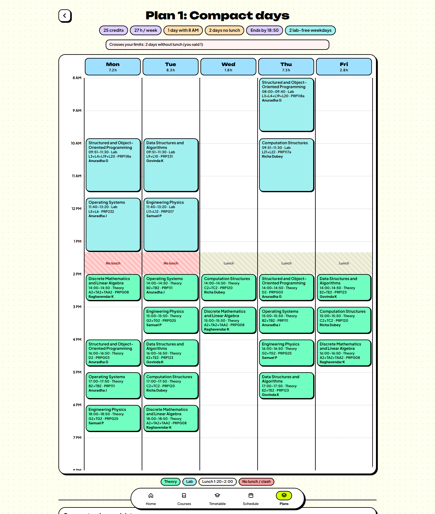
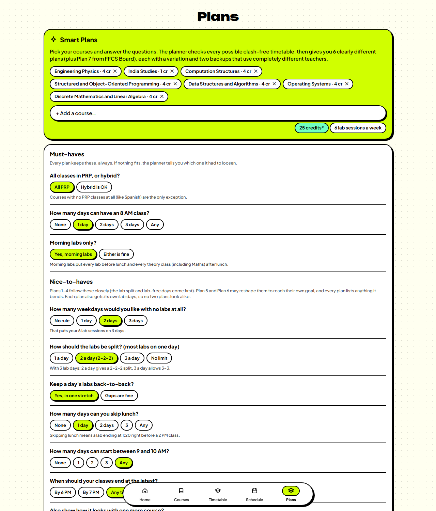
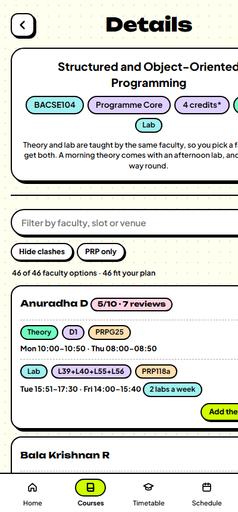
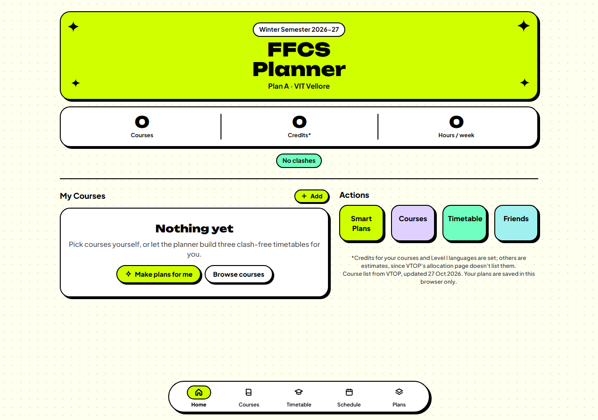
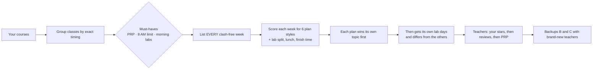

<p align="center">
  <a href="https://ffcs-planner-psi.vercel.app"></a>
</p>

<p align="center">
  <a href="https://ffcs-planner-psi.vercel.app"></a>
  <a href="#-contributing"></a>
  <a href="LICENSE"></a>
</p>

<p align="center">
  
  
  
  <a href="https://github.com/pranavvehmid/ffcs-planner/actions/workflows/tests.yml"></a>
</p>

<h3 align="center">Stop fighting FFCS. Answer a few questions and get six clash-free VIT timetables that actually look different from each other.</h3>

---

## ✦ What it does

**FFCS Planner** is a free, open-source timetable planner for **VIT Vellore's Fully Flexible Credit System (FFCS)**, built for **Winter Semester 2026-27**. Pick your courses, tell it what you care about (no 8 AMs, lunch breaks, labs in the morning, PRP only…), and it checks **every possible clash-free timetable** before handing you the best ones.

| | | |
|:--|:--|:--|
| 🟩 **Every timetable checked** <br> Lists all clash-free weeks (often 30,000+) and scores each one. No guessing, no sampling. | 🟪 **Six plans, six personalities** <br> Compact days · Late starts · Done early · Top-rated teachers · Most lab-free days · Two heavy days. | 🟦 **Backups with new teachers** <br> Every plan has Backup B and C that share **no** teacher with Plan A, for when a section fills up. |
| 🟨 **Real questions** <br> 8 AM days, lab-free days, lab split (2-2-2 vs 3-3), labs back-to-back, lunch skips, finish time, PRP or hybrid. | 🟧 **Honest warnings** <br> If your answers can't all be met, it says exactly which one bends and why. | 🩷 **Friends overlay** <br> Share a `W26-…` code, overlay friends' weeks and spot common free hours. |
| 🩵 **Full-page timetable** <br> Big week view with teacher, slot, venue and lunch marked. Print it or share the link. | ⭐ **Teacher reviews** <br> Star teachers, avoid others, and see community ratings while you pick. | 📱 **Phone friendly** <br> Mobile-first; your plans stay in your own browser. |

## ✦ Screenshots

<p align="center">
  
</p>
<p align="center">
  
  
</p>
<p align="center">
  
</p>

## ✦ How the planner thinks



- **Must-haves** are never broken. If nothing fits, the planner loosens one rule at a time and tells you which.
- **Nice-to-haves** are scored. Plans 1–4 follow them as closely as any timetable can. Plan 5 and Plan 6 may reshape them to reach their own goal.
- The engine is plain JavaScript in [`site/planner.js`](site/planner.js). It runs in a Web Worker in the browser and in Node for tests.

## ✦ Run it locally

No install and no build step. Any static server works:

```bash
cd site
python -m http.server 8000
```

Then open http://localhost:8000.

## ✦ Tests

The test runner throws random combinations of courses and answers at the engine. After every run it checks that no class clashes, the must-haves hold, Plans 1–4 keep your lab split, backups never reuse a teacher, plans differ, and each plan reaches (or nearly reaches) the best possible week for its topic.

```bash
node tests/run-tests.js 200      # 200 random cases
node tests/run-tests.js 1000 42  # 1,000 cases with seed 42
```

## ✦ Project layout

```
site/                the website (open index.html, or deploy the folder)
  planner.js         the planning engine (no DOM)
  planner-worker.js  runs the engine off the main thread
  app.js             the interface
  data.js            course list (built from data/)
  ratings.js         community ratings
data/                raw course allocation data (JSON + CSV)
tools/               scripts that build site/data.js
tests/               randomized engine tests
docs/                banner and screenshots
```

## ✦ Contributing

Contributions are very welcome, from your first ever pull request to a full new feature. Start with [CONTRIBUTING.md](CONTRIBUTING.md), then pick something below or open an issue.

**Good first ideas**
- 🧪 Add a test for a tricky case you hit in real FFCS registration.
- 🎨 Polish a screen (dark mode, animations, accessibility).
- 🗂️ Add course data for **other branches** (CSE first-year courses are the best tested today).
- 🏫 Support **VIT Chennai / AP / Bhopal** slot grids.
- ⭐ Bring in more teacher reviews with clear sources.
- 🧾 Export a plan as an image, PDF or `.ics` calendar.

Please be kind and follow the [Code of Conduct](CODE_OF_CONDUCT.md).

## ✦ Notes

- Course and slot data come from VTOP's *Course Allocation Details* page for Winter 2026-27. Always double-check in VTOP before you register.
- Credits for the core first-year CSE courses and Level I languages are set by hand; others are estimates.
- Community ratings are a hint, not a verdict: many teachers have only a few reviews.
- Not affiliated with VIT.

<p align="center"><b>If this saved you an FFCS headache, give it a ⭐ and share it with your batch.</b></p>
